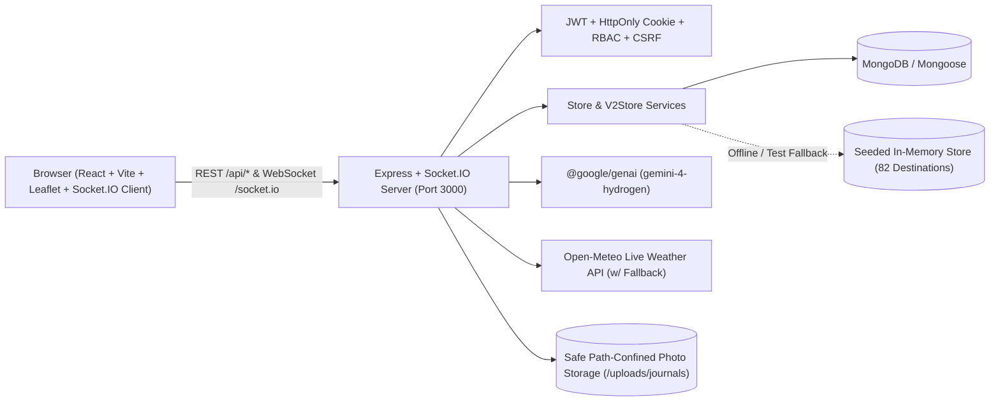

# Travelogia 2.0 — Intelligent Travel Discovery & Collaborative Planning Platform

Travelogia 2.0 is a full-stack MERN + Socket.IO + Gemini AI travel discovery, booking, and collaborative trip planning platform built with Express, MongoDB/Mongoose (with automatic offline seeded fallback), React + Vite, Leaflet + OpenStreetMap, and `@google/genai`.

---

## System Architecture



---

## Core Platform + Travelogia 2.0 Features (All 12 Implemented)

### Core Travelogia Platform
- **82 Curated Destinations** across India (including Northeast India & North Bengal) and global icons with server-side pagination, search, category/country/price/rating filters, interactive Leaflet maps, favorites wishlist, and server-verified bookings with capacity & duplicate checks.
- **Travelogia AI Assistant** floating chat grounded in Travelogia's destination database.
- **Role-Based Admin Dashboard** (`/admin-profile`) for destination CRUD, booking oversight, and user management.

### Travelogia 2.0 Smart Planning Suite
1. **AI-Powered Smart Trip Builder (`/trip-builder`)** — Structured JSON day-by-day itinerary generation via Gemini (`gemini-4-hydrogen`), strict DB destination ID validation, authoritative server-side budget calculation, single-day regeneration, notes editing, and route map visualization.
2. **Intelligent Budget Optimizer (`/budget-optimizer`)** — 7-category deterministic cost estimator (USD/INR), over-budget detection with exact target-budget revised allocation, cheaper catalogue alternatives, multi-tier comparison, manual overrides, and actual vs. estimated spend tracking.
3. **Collaborative Trip Planning (`/collaborate`)** — Real-time Socket.IO workspace on port 3000 with private trip rooms, 8-character invite codes, Owner/Editor/Viewer RBAC, live online presence, destination & activity voting, task assignments, discussion chat, and expense splitting.
4. **Route Intelligence & Multi-Destination Optimizer (`/route-planner`)** — Nearest-Neighbour + 2-Opt TSP heuristic optimizer, Haversine straight-line km clearly separated from estimated road km, stop reordering, interactive Leaflet polyline map, and direct OpenStreetMap & Google Maps links.
5. **Travel Readiness & Risk Intelligence (embedded on `/travels/:id`)** — Live Open-Meteo weather (with timeout & honest fallback), permits, road access, emergency contacts, preparation checklist, and transparent 0–100 Travel Readiness Score.
6. **Hidden Gems Discovery Engine (`/hidden-gems`)** — "Beyond the Tourist Trail" featuring 12 curated Northeast India & North Bengal offbeat destinations (Ziro Valley, Majuli, Dawki, Tawang, Dzükou Valley, Sandakphu, Lava/Lolegaon, Dooars, Kurseong, Sittong, Lepchajagat, Mechuka) plus global hidden gems, region/season/budget/distance filters, Grid/Map toggle, and AI offbeat recommendations.
7. **Smart Destination Comparison (`/compare` + tray on `/travels`)** — Compare up to 3 destinations side-by-side with advantage badges, starting-city distance, 3-state accessibility rows, and grounded Gemini comparison summary.
8. **Personalized Travel Recommendation Engine (embedded on `/` & `/travels/:id`)** — Transparent rule-based weighted scoring (Interest 30%, Budget 25%, Category 20%, Season 15%, Duration 10%) with clear explanations, customizable preferences, reset option, and Similar Destinations.
9. **Travel Memory Journal (`/journal`)** — Create, edit, and delete travel stories with Multer photo uploads (JPEG/PNG/WEBP, max 5 MB, path-confined serving), visited-places map, star ratings, tags, and strict private vs. public authorization.
10. **Smart Packing Assistant (`/packing`)** — Weather-, season-, duration-, and activity-aware 7-category packing checklists, progress tracking, custom items, reusable templates, and optional Gemini tips with non-medical disclaimer.
11. **Travel Deal & Price Watcher (`/price-watcher` + Navbar Bell)** — Historical estimated nightly price SVG trend charts, user price observation logging, target-budget alerts, background alert evaluation scheduler, and persistent Notification Inbox.
12. **Accessibility-Aware Travel Discovery (`/travels`, `/travels/:id`, `/compare`)** — Strict 3-state (`yes` / `no` / `unknown`) accessibility attributes where `unknown` is never treated as accessible, plus authenticated community accessibility reporting.

---

## Key API Endpoints

| Domain | Endpoints |
|--------|-----------|
| Auth & Profile | `POST /api/signup`, `POST /api/login`, `POST /api/auth/logout`, `GET /api/auth/me`, `GET/PUT /api/profile` |
| Destinations & Accessibility | `GET /api/travels`, `GET /api/travels/facets`, `GET /api/travels/:id`, `POST /api/travels/:id/accessibility` |
| Bookings & Favorites | `GET/POST /api/bookings`, `PATCH /api/bookings/:id/cancel`, `GET/POST/DELETE /api/favorites` |
| AI Trip Builder | `POST /api/itineraries/generate`, `POST /api/itineraries/:id/regenerate-day`, `GET/PUT/DELETE /api/itineraries` |
| Budget Optimizer | `POST /api/budgets/calculate`, `POST /api/budgets/compare`, `GET/POST/PUT/DELETE /api/budgets` |
| Collaborative Trips | `GET/POST /api/trips`, `POST /api/trips/join`, `GET /api/trips/:id`, `PATCH /api/trips/:id/members/:userId`, destinations/activities/votes/comments/expenses + Socket.IO `/socket.io` |
| Route & Readiness | `GET /api/routes/hubs`, `POST /api/routes/optimize`, `GET /api/readiness/:travelId` |
| Hidden Gems & Compare | `GET /api/hidden-gems`, `POST /api/hidden-gems/ai-suggestions`, `POST /api/compare`, `POST /api/compare/ai-summary` |
| Recommendations | `GET /api/recommendations`, `GET /api/recommendations/similar/:travelId`, `POST /api/recommendations/track-view`, `PUT /api/recommendations/preferences`, `POST /api/recommendations/reset` |
| Journal & Packing | `GET /api/journals/public`, `GET /api/journals/mine`, `GET/POST/PUT/DELETE /api/journals`, `GET /api/journals/photo/:filename`, `POST /api/packing/generate`, `GET/POST/PUT/DELETE /api/packing` |
| Price Watch & Alerts | `GET /api/price-watch/history/:travelId`, `POST /api/price-watch/observations`, `GET/POST/DELETE /api/price-watch/alerts`, `POST /api/price-watch/alerts/evaluate`, `GET /api/price-watch/notifications`, `PATCH /api/price-watch/notifications/:id/read` |

---

## Environment Variables (`.env.example`)
- `PORT=3000`
- `MONGODB_URI` — MongoDB Atlas/local URI (falls back cleanly to seeded in-memory store if unreachable)
- `JWT_SECRET` — Strong secret for signing HS256 auth tokens
- `GEMINI_API_KEY` — Server-side Google Gemini API key (never exposed to browser)
- `GEMINI_MODEL=gemini-4-hydrogen`
- `FRONTEND_URL` — Allowed frontend origin(s)
- `ADMIN_SETUP_SECRET` — Optional secret for initial admin bootstrap
- `VITE_API_URL=/api`

---

## Running & Testing Locally
```bash
# Install dependencies
npm install

# Build frontend production bundle
npm run build

# Start unified Express + Socket.IO + SPA server on port 3000
npm start

# Run automated Vitest + Supertest suite (37 tests)
NODE_ENV=test npx vitest run --reporter=verbose

# Lint frontend
npm run lint
```
