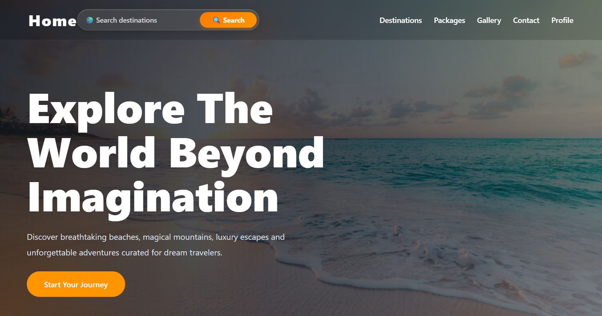
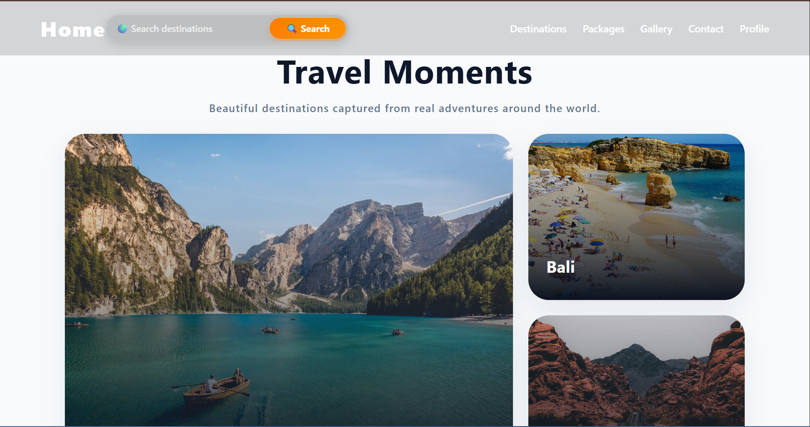
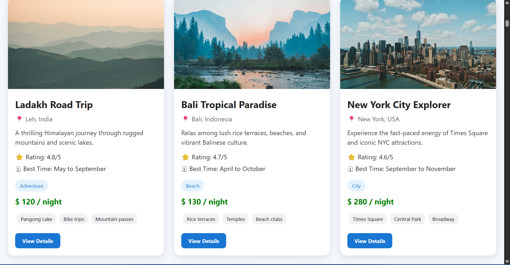
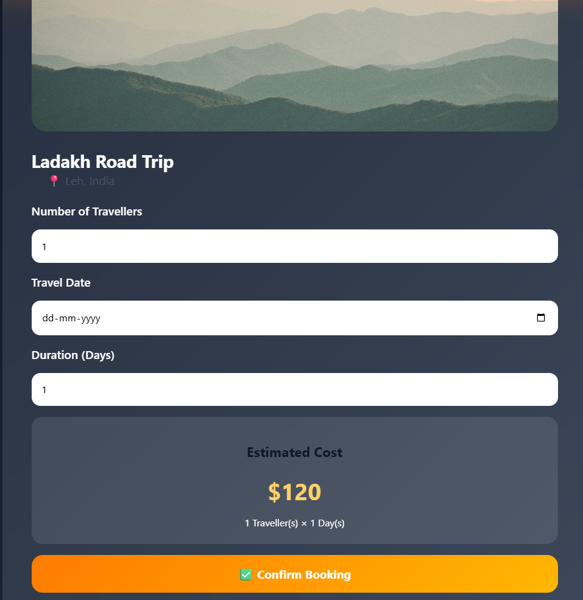
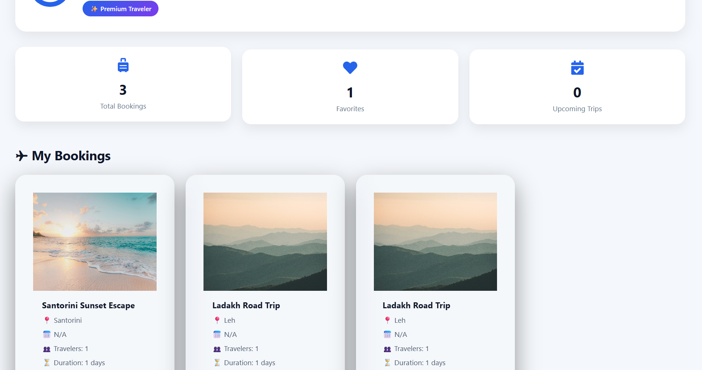

# 🌍 Travelogia

A full-stack travel booking web application built using the MERN stack that allows users to explore destinations, save favorites, manage bookings, and plan their trips through a modern and responsive user interface.

## 🚀 Live Demo

**Frontend:** https://travelogia-8m7e.vercel.app/

**Backend API:** https://travelogia-nfpk.onrender.com/

---

## 📖 Overview

Travelogia is a travel exploration and booking platform designed to provide users with an intuitive way to discover destinations and manage their travel plans.

The application includes secure authentication, destination search, booking management, favorite destinations, and a personalized user dashboard.

This project was built to strengthen my full-stack development skills, covering frontend development, backend API design, database management, authentication, deployment, and real-world application architecture.

---

## ✨ Features

### User Authentication

* User Registration
* User Login & Logout
* JWT Authentication
* Protected Routes

### Destination Management

* Browse Destinations
* Search Destinations
* View Destination Details
* Responsive Destination Cards

### Booking System

* Book Travel Destinations
* View Booking History
* Manage User Bookings

### Favorites

* Add Destinations to Favorites
* Remove Favorites
* Personalized Favorite List

### User Dashboard

* Profile Information
* Booking Overview
* Favorite Destinations
* User Account Management

### Responsive Design

* Mobile Friendly
* Tablet Friendly
* Desktop Optimized

---

## 🛠️ Tech Stack

### Frontend

* React.js
* React Router DOM
* Axios
* CSS3

### Backend

* Node.js
* Express.js

### Database

* MongoDB
* Mongoose

### Authentication

* JSON Web Tokens (JWT)
* bcrypt.js

### Deployment

* Vercel (Frontend)
* Render (Backend)

### Version Control

* Git
* GitHub

---

## 📂 Project Structure

Travelogia/

├── frontend/

│ ├── src/

│ ├── components/

│ ├── pages/

│ ├── assets/

│ └── App.js

│

├── backend/

│ ├── models/

│ ├── routes/

│ ├── controllers/

│ ├── middleware/

│ └── app.js

│

└── README.md

---

## 📸 Screenshots

<h3>Home Page</h3>

<h3>Destinations Page</h3>

<h3>Booking Page</h3>

<h3>User Dashboard</h3>

## ⚙️ Installation

### Clone Repository

git clone https://github.com/yourusername/Travelogia.git
cd Travelogia

### Backend Setup

cd backend
npm install

Create a .env file:

MONGO_URI=your_mongodb_connection_string
JWT_SECRET=your_secret_key
PORT=5000

Run Backend:

npm start

### Frontend Setup

cd frontend
npm install
npm run dev

---

## 🧠 Challenges Faced

* Implementing secure JWT-based authentication
* Managing user-specific bookings and favorites
* Connecting React frontend with Express backend APIs
* Handling deployment on Render and Vercel
* Managing environment variables securely
* Designing responsive UI components

---

## 🎯 Future Improvements

* Payment Gateway Integration
* AI Travel Recommendation System
* Hotel Booking Integration
* Email Notifications
* User Reviews & Ratings
* Admin Dashboard
* Advanced Filters and Sorting

---

## 📚 What I Learned

Through this project, I gained hands-on experience with:

* Building RESTful APIs
* React State Management
* Authentication & Authorization
* MongoDB Data Modeling
* Deployment Workflows
* Git & GitHub Collaboration
* Full-Stack Application Development

---

## 👩‍💻 Author

Nisat Sama

B.Tech Computer Science Engineering

Aspiring Software Developer

GitHub: https://github.com/nisatsama

LinkedIn: linkedin.com/in/nisat-sama-aa02a53a3

---

## ⭐ Support

If you found this project useful, consider giving it a star on GitHub.
