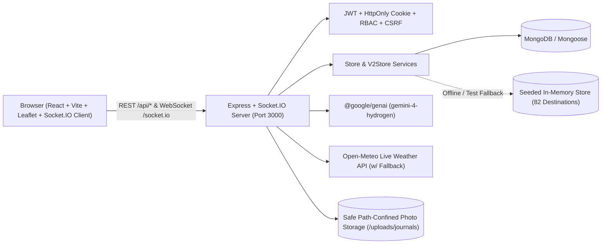

# Travelogia 2.0 — Intelligent Travel Discovery & Collaborative Planning Platform

Travelogia 2.0 is a full-stack MERN + Socket.IO + Gemini AI travel discovery, booking, and collaborative trip planning platform built with Express, MongoDB/Mongoose (with automatic offline seeded fallback), React + Vite, Leaflet + OpenStreetMap, and `@google/genai`.

---

## System Architecture



---

## Core Platform + Travelogia 2.0 Features (All 12 Implemented)

### Core Travelogia Platform
- **82 Curated Destinations** across India (including Northeast India & North Bengal) and global icons with server-side pagination, search, category/country/price/rating filters, interactive Leaflet maps, favorites wishlist, and server-verified bookings with capacity & duplicate checks.
- **Travelogia AI Assistant** floating chat grounded in Travelogia's destination database.
- **Role-Based Admin Dashboard** (`/admin-profile`) for destination CRUD, booking oversight, and user management.

### Travelogia 2.0 Smart Planning Suite
1. **AI-Powered Smart Trip Builder (`/trip-builder`)** — Structured JSON day-by-day itinerary generation via Gemini (`gemini-4-hydrogen`), strict DB destination ID validation, authoritative server-side budget calculation, single-day regeneration, notes editing, and route map visualization.
2. **Intelligent Budget Optimizer (`/budget-optimizer`)** — 7-category deterministic cost estimator (USD/INR), over-budget detection with exact target-budget revised allocation, cheaper catalogue alternatives, multi-tier comparison, manual overrides, and actual vs. estimated spend tracking.
3. **Collaborative Trip Planning (`/collaborate`)** — Real-time Socket.IO workspace on port 3000 with private trip rooms, 8-character invite codes, Owner/Editor/Viewer RBAC, live online presence, destination & activity voting, task assignments, discussion chat, and expense splitting.
4. **Route Intelligence & Multi-Destination Optimizer (`/route-planner`)** — Nearest-Neighbour + 2-Opt TSP heuristic optimizer, Haversine straight-line km clearly separated from estimated road km, stop reordering, interactive Leaflet polyline map, and direct OpenStreetMap & Google Maps links.
5. **Travel Readiness & Risk Intelligence (embedded on `/travels/:id`)** — Live Open-Meteo weather (with timeout & honest fallback), permits, road access, emergency contacts, preparation checklist, and transparent 0–100 Travel Readiness Score.
6. **Hidden Gems Discovery Engine (`/hidden-gems`)** — "Beyond the Tourist Trail" featuring 12 curated Northeast India & North Bengal offbeat destinations (Ziro Valley, Majuli, Dawki, Tawang, Dzükou Valley, Sandakphu, Lava/Lolegaon, Dooars, Kurseong, Sittong, Lepchajagat, Mechuka) plus global hidden gems, region/season/budget/distance filters, Grid/Map toggle, and AI offbeat recommendations.
7. **Smart Destination Comparison (`/compare` + tray on `/travels`)** — Compare up to 3 destinations side-by-side with advantage badges, starting-city distance, 3-state accessibility rows, and grounded Gemini comparison summary.
8. **Personalized Travel Recommendation Engine (embedded on `/` & `/travels/:id`)** — Transparent rule-based weighted scoring (Interest 30%, Budget 25%, Category 20%, Season 15%, Duration 10%) with clear explanations, customizable preferences, reset option, and Similar Destinations.
9. **Travel Memory Journal (`/journal`)** — Create, edit, and delete travel stories with Multer photo uploads (JPEG/PNG/WEBP, max 5 MB, path-confined serving), visited-places map, star ratings, tags, and strict private vs. public authorization.
10. **Smart Packing Assistant (`/packing`)** — Weather-, season-, duration-, and activity-aware 7-category packing checklists, progress tracking, custom items, reusable templates, and optional Gemini tips with non-medical disclaimer.
11. **Travel Deal & Price Watcher (`/price-watcher` + Navbar Bell)** — Historical estimated nightly price SVG trend charts, user price observation logging, target-budget alerts, background alert evaluation scheduler, and persistent Notification Inbox.
12. **Accessibility-Aware Travel Discovery (`/travels`, `/travels/:id`, `/compare`)** — Strict 3-state (`yes` / `no` / `unknown`) accessibility attributes where `unknown` is never treated as accessible, plus authenticated community accessibility reporting.

### Complete Travel Commerce System (Modules 13–29)
13. **Hotel Booking Engine (`/stays`)** — Destination, date, guest, room, category, price, rating, and amenity search; property details & galleries; room selection; atomic double-booking prevention; server-side seasonal pricing; confirmation & cancellation workflows.
14. **Room Inventory Management (`/stays`, `POST/PATCH /api/stays/*/rooms`)** — Single, Double, Deluxe, Suite, and Family room categories with capacity, seasonal pricing multipliers, availability status, and atomic inventory lock/release on confirmation or cancellation.
15. **Homestays & Vacation Rentals (`/stays`)** — Supports Hotels, Homestays, Hostels, Villas, Resorts, Guesthouses, and Apartments with verified host profiles, images, amenities, and bookings.
16. **Hotel Review System (`/stays`)** — Verified completed-stay reviews only (rejects uncompleted stays or non-guests with 403), overall/cleanliness/location/service scores, photo uploads, owner responses, and admin moderation.
17. **Flight Search & Booking Integration (`/transport`)** — Origin/destination airports, departure/return dates, passengers, cabin class, and airline filters with honest official portal comparison redirects when no live GDS API is configured, plus external PNR saving to the trip timeline.
18. **Train Journey Planner (`/transport`)** — Station search, reference Indian Railways schedules & classes, official IRCTC/NTES booking & live running status links (never fabricates live IRCTC availability), and external PNR tracking.
19. **Bus Booking System (`/transport`)** — Route search, boarding/dropping points, operator profiles, interactive 24-seat coach layouts with sleeper modifiers, seat-level double-booking prevention, and cancellation on clearly labelled demo operators.
20. **Car Rental & Local Transport (`/transport`)** — Self-drive, chauffeur-driven, airport transfer, and local cab bookings with vehicle categories, driver profiles, server-side pricing, and cancellation.
21. **Unified Transport Management (`/transport`)** — Connects external flight/train PNRs, bus bookings, and car/cab rentals into one chronological transport timeline linked to the user's trip.
22. **Activities & Experiences Booking (`/experiences`)** — All 8 categories (Adventure Sports, Trekking, Guided Sightseeing, Cultural Experience, Local Tour, Water Sports, Workshop, Nature Experience) with time-slot capacity tracking and overbooking prevention.
23. **Local Tour Guide Marketplace (`/experiences`)** — Guide profiles with languages, expertise, daily pricing, booking requests, guide/customer status workflow, and verified completed-booking reviews.
24. **Restaurant Discovery & Reservations (`/experiences`)** — City & cuisine filters with table reservations confirmed strictly against configured restaurant time-slot seat capacity.
25. **Unified Trip Dashboard (`/dashboard`)** — Central authenticated hub aggregating stay reservations, transport timeline, activities, tour guides, dining, AI itineraries, budgets, Razorpay payment history & invoices, travel journal, wallet documents, and smart notifications.
26. **Razorpay Payment Gateway (`/dashboard`, `/api/payments/*`)** — Official `razorpay` Node SDK + Checkout JS SDK with authoritative server-side order amounts, HMAC-SHA256 `timingSafeEqual` signature verification, raw-body `X-Razorpay-Signature` signed webhooks, refunds, transaction history, and structured invoices.
27. **Digital Travel Wallet (`/wallet`)** — Central private vault for hotel confirmations, flight/train refs, bus tickets, activity vouchers, payment receipts, and private PDF/image uploads with owner-only download access control and reference-only QR codes (explicitly labelled as not official carrier boarding passes).
28. **Smart Travel Notifications (`/dashboard` & Navbar Bell)** — In-app notifications for bookings, payments, cancellations, price alerts, and scheduled 48-hour check-in/transport/activity reminders with read/unread state and customizable notification preferences.
29. **Travel Insurance Discovery (`/wallet`)** — Informational directory of licensed insurers (Tata AIG, HDFC ERGO, ICICI Lombard, Allianz Travel) with official external quotation redirects and strict non-underwriting / non-AI-advice disclosure.

---

## Key API Endpoints

| Domain | Endpoints |
|--------|-----------|
| Auth & Profile | `POST /api/signup`, `POST /api/login`, `POST /api/auth/logout`, `GET /api/auth/me`, `GET/PUT /api/profile` |
| Destinations & Accessibility | `GET /api/travels`, `GET /api/travels/facets`, `GET /api/travels/:id`, `POST /api/travels/:id/accessibility` |
| Bookings & Favorites | `GET/POST /api/bookings`, `PATCH /api/bookings/:id/cancel`, `GET/POST/DELETE /api/favorites` |
| AI Trip Builder | `POST /api/itineraries/generate`, `POST /api/itineraries/:id/regenerate-day`, `GET/PUT/DELETE /api/itineraries` |
| Budget Optimizer | `POST /api/budgets/calculate`, `POST /api/budgets/compare`, `GET/POST/PUT/DELETE /api/budgets` |
| Collaborative Trips | `GET/POST /api/trips`, `POST /api/trips/join`, `GET /api/trips/:id`, `PATCH /api/trips/:id/members/:userId`, destinations/activities/votes/comments/expenses + Socket.IO `/socket.io` |
| Route & Readiness | `GET /api/routes/hubs`, `POST /api/routes/optimize`, `GET /api/readiness/:travelId` |
| Hidden Gems & Compare | `GET /api/hidden-gems`, `POST /api/hidden-gems/ai-suggestions`, `POST /api/compare`, `POST /api/compare/ai-summary` |
| Recommendations | `GET /api/recommendations`, `GET /api/recommendations/similar/:travelId`, `POST /api/recommendations/track-view`, `PUT /api/recommendations/preferences`, `POST /api/recommendations/reset` |
| Journal & Packing | `GET /api/journals/public`, `GET /api/journals/mine`, `GET/POST/PUT/DELETE /api/journals`, `GET /api/journals/photo/:filename`, `POST /api/packing/generate`, `GET/POST/PUT/DELETE /api/packing` |
| Price Watch & Alerts | `GET /api/price-watch/history/:travelId`, `POST /api/price-watch/observations`, `GET/POST/DELETE /api/price-watch/alerts`, `POST /api/price-watch/alerts/evaluate`, `GET /api/price-watch/notifications`, `PATCH /api/price-watch/notifications/:id/read` |
| Stays, Rooms & Reviews (M13–16) | `GET/POST /api/stays`, `GET /api/stays/:id`, `POST /api/stays/:id/rooms`, `PATCH /api/stays/rooms/:roomTypeId`, `POST /api/stays/bookings`, `GET /api/stays/bookings/mine`, `PATCH /api/stays/bookings/:bookingId/cancel`, `PATCH /api/stays/bookings/:bookingId/complete`, `POST /api/stays/:id/reviews`, `PATCH /api/stays/reviews/:reviewId/respond`, `PATCH /api/stays/reviews/:reviewId/moderate` |
| Transport Hub (M17–21) | `GET /api/transport/flights/airports`, `GET /api/transport/flights/search`, `POST /api/transport/flights/save-reference`, `GET /api/transport/trains/stations`, `GET /api/transport/trains/search`, `POST /api/transport/trains/save-reference`, `GET /api/transport/buses/search`, `POST /api/transport/buses/book`, `GET /api/transport/cars/search`, `POST /api/transport/cars/book`, `GET /api/transport/reservations/mine`, `PATCH /api/transport/reservations/:id/cancel` |
| Experiences, Guides & Dining (M22–24) | `GET /api/experiences/activities`, `POST /api/experiences/activities/book`, `GET /api/experiences/guides`, `POST /api/experiences/guides/book`, `PATCH /api/experiences/guides/bookings/:id/status`, `POST /api/experiences/guides/:id/reviews`, `GET /api/experiences/restaurants`, `POST /api/experiences/restaurants/reserve` |
| Unified Dashboard, Razorpay, Wallet, Notifications & Insurance (M25–29) | `GET /api/dashboard`, `GET /api/payments/config`, `POST /api/payments/orders`, `POST /api/payments/verify`, `POST /api/payments/webhook`, `POST /api/payments/:id/refund`, `GET /api/payments/history`, `GET /api/payments/:id/invoice`, `GET/POST /api/wallet`, `GET /api/wallet/:id/file`, `GET /api/wallet/:id/qr`, `DELETE /api/wallet/:id`, `GET /api/notifications`, `PUT /api/notifications/preferences`, `POST /api/notifications/run-reminders`, `GET /api/insurance/providers` |

---

## Environment Variables (`.env.example`)
- `PORT=3000`
- `MONGODB_URI` — MongoDB Atlas/local URI (falls back cleanly to seeded in-memory store if unreachable)
- `JWT_SECRET` — Strong secret for signing HS256 auth tokens
- `GEMINI_API_KEY` — Server-side Google Gemini API key (never exposed to browser)
- `GEMINI_MODEL=gemini-4-hydrogen`
- `RAZORPAY_KEY_ID` — Razorpay Key ID (server-side; exposed only via `/api/payments/config` when configured)
- `RAZORPAY_KEY_SECRET` — Razorpay Key Secret (strictly server-side for order creation & HMAC verification)
- `RAZORPAY_WEBHOOK_SECRET` — Razorpay Webhook Secret (strictly server-side for `X-Razorpay-Signature` verification)
- `FLIGHT_PROVIDER_API_KEY` — Optional authorized GDS/flight provider key
- `FRONTEND_URL` — Allowed frontend origin(s)
- `ADMIN_SETUP_SECRET` — Optional secret for initial admin bootstrap
- `VITE_API_URL=/api`

---

## Running & Testing Locally
```bash
# Install dependencies
npm install

# Build frontend production bundle
npm run build

# Start unified Express + Socket.IO + SPA server on port 3000
npm start

# Run automated Vitest + Supertest suite
NODE_ENV=test npx vitest run --reporter=verbose

# Lint frontend
npm run lint
```
